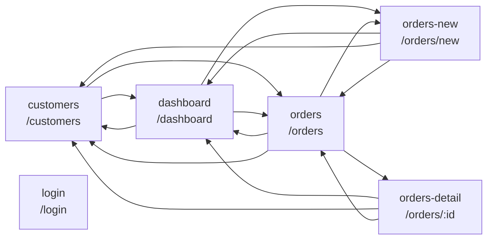

# Navigation map

## Curated notes

- —

<!-- AUTO-GENERATED:START (explorer overwrites this block; edit outside it) -->
## Screens and links (auto)

| Screen | Route | Login | Reached from | Links to |
|---|---|---|---|---|
| [customers](screens/customers.md) | `/customers` | yes | customers, dashboard, orders-detail--completed, orders-detail, orders-new, orders | [dashboard](screens/dashboard.md), [customers](screens/customers.md), [orders](screens/orders.md) |
| [dashboard](screens/dashboard.md) | `/dashboard` | yes | customers, dashboard, orders-detail--completed, orders-detail, orders-new, orders | [dashboard](screens/dashboard.md), [customers](screens/customers.md), [orders](screens/orders.md), [orders-new](screens/orders-new.md) |
| [login](screens/login.md) | `/login` | no | — | — |
| [orders-detail--completed](screens/orders-detail--completed.md) (variant) | `/orders/:id` | yes | orders | [dashboard](screens/dashboard.md), [customers](screens/customers.md), [orders](screens/orders.md) |
| [orders-detail](screens/orders-detail.md) | `/orders/:id` | yes | orders | [dashboard](screens/dashboard.md), [customers](screens/customers.md), [orders](screens/orders.md) |
| [orders-new](screens/orders-new.md) | `/orders/new` | yes | dashboard, orders | [dashboard](screens/dashboard.md), [customers](screens/customers.md), [orders](screens/orders.md) |
| [orders](screens/orders.md) | `/orders` | yes | customers, dashboard, orders-detail--completed, orders-detail, orders-new, orders | [dashboard](screens/dashboard.md), [customers](screens/customers.md), [orders](screens/orders.md), [orders-new](screens/orders-new.md), [orders-detail](screens/orders-detail.md) |

<!-- AUTO-GENERATED:END -->
