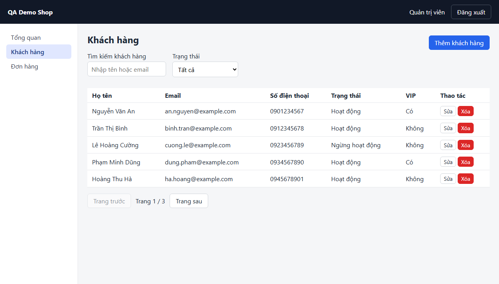
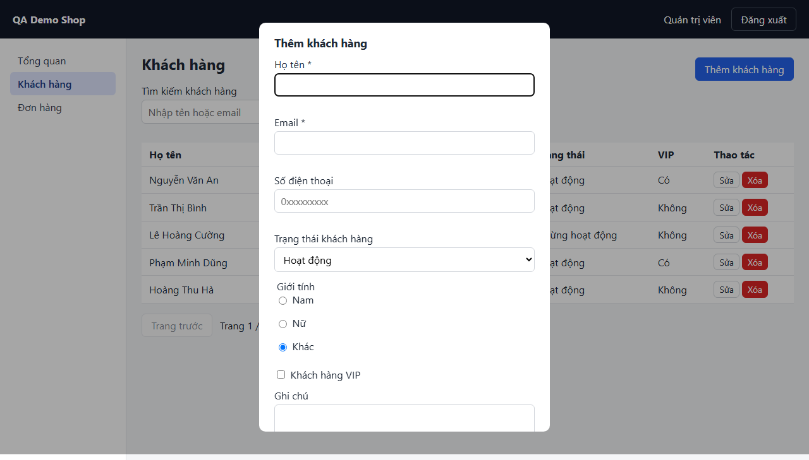
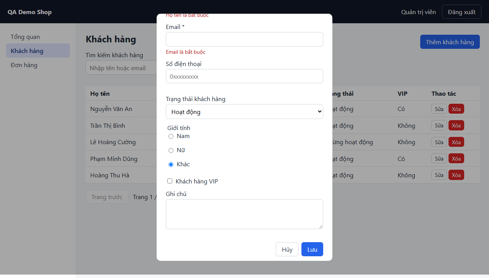
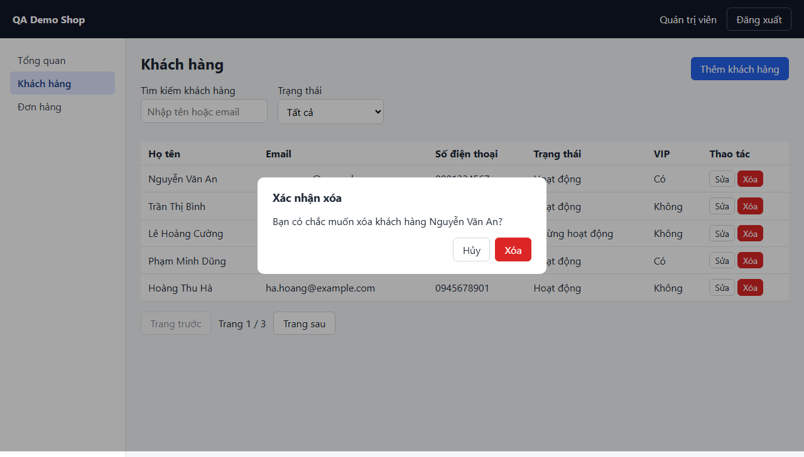

# Screen: customers

## Curated notes (AI/QA maintained — explorer never overwrites this section)

- **Purpose:** UNKNOWN — fill in from business docs or QA. Mark inferred statements with _(inferred, unverified)_.
- **Business rules / validation:** UNKNOWN
- **Dependencies on other screens:** UNKNOWN
- **Test data needs:** UNKNOWN
- **Known limitations / open questions:** —

<!-- AUTO-GENERATED:START (explorer overwrites this block; edit outside it) -->
## Overview (auto)

- **Route:** `/customers` — explored URL: http://localhost:4000/customers
- **Requires login:** yes
- **Document title:** Khách hàng · QA Demo Shop
- **Headings:** h1 "Khách hàng"
- **Last explored:** 2026-11-07T12:09:09.302Z
- **Screenshot:** 

### Changes since previous exploration (2026-11-07T12:01:07.496Z)

- ➕ searchbox · Tìm kiếm khách hàng · `page.getByRole('searchbox', { name: 'Tìm kiếm khách hàng' })`
- ➕ [state add-customer-modal] button · Lưu · `page.getByRole('dialog', { name: 'Thêm khách hàng' }).getByRole('button', { name: 'Lưu' })`
- ➕ [state add-customer-empty-submit] button · Lưu · `page.getByRole('dialog', { name: 'Thêm khách hàng' }).getByRole('button', { name: 'Lưu' })`
- ➖ searchbox · Tìm khách hàng · `page.getByRole('searchbox', { name: 'Tìm khách hàng' })`
- ➖ [state add-customer-modal] button · Lưu thông tin · `page.getByRole('dialog', { name: 'Thêm khách hàng' }).getByRole('button', { name: 'Lưu thông tin' })`
- ➖ [state add-customer-empty-submit] button · Lưu thông tin · `page.getByRole('dialog', { name: 'Thêm khách hàng' }).getByRole('button', { name: 'Lưu thông tin' })`

## Interactive elements

| # | Type | Accessible name | Selector (verified unique) | Notes |
|---|---|---|---|---|
| 1 | button | Đăng xuất | `page.getByRole('button', { name: 'Đăng xuất' })` |  |
| 2 | link | Tổng quan | `page.getByRole('link', { name: 'Tổng quan' })` | href /dashboard |
| 3 | link | Khách hàng | `page.getByRole('link', { name: 'Khách hàng' })` | aria-current=page; href /customers |
| 4 | link | Đơn hàng | `page.getByRole('link', { name: 'Đơn hàng' })` | href /orders |
| 5 | button | Thêm khách hàng | `page.getByTestId('btn-add-customer')` |  |
| 6 | searchbox | Tìm kiếm khách hàng | `page.getByRole('searchbox', { name: 'Tìm kiếm khách hàng' })` | type=search |
| 7 | combobox | Trạng thái | `page.getByRole('combobox', { name: 'Trạng thái', exact: true })` | options: Tất cả / Hoạt động / Ngừng hoạt động; stricter selector: the looser one is ambiguous in state "add-customer-modal" |
| 8 | button | Trang trước | `page.getByRole('button', { name: 'Trang trước' })` | disabled |
| 9 | button | Trang sau | `page.getByRole('button', { name: 'Trang sau' })` |  |

## Forms and fields

_No <form> elements visible._

## Tables

### Table "Danh sách khách hàng" — `page.getByRole('table', { name: 'Danh sách khách hàng' })`

- Columns: `Họ tên` | `Email` | `Số điện thoại` | `Trạng thái` | `VIP` | `Thao tác`
- Visible rows at exploration time: 5
- Sample first row: "Nguyễn Văn An", "an.nguyen@example.com", "0901234567", "Hoạt động", "Có", "Sửa Xóa"
- Row-level controls (locate the row first, e.g. `const row = page.getByRole('table', { name: 'Danh sách khách hàng' }).getByRole('row').filter({ hasText: '<unique cell text>' })`):

| # | Type | Accessible name | Selector (verified unique) | Notes |
|---|---|---|---|---|
| 1 | button | Sửa | `row.getByRole('button', { name: 'Sửa' })` | per-row control in table "Danh sách khách hàng" (5 visible rows) |
| 2 | button | Xóa | `row.getByRole('button', { name: 'Xóa' })` | per-row control in table "Danh sách khách hàng" (5 visible rows) |

## Dialogs / modals

- dialog "Thêm khách hàng" — present in DOM but hidden on load (opened by an action; see States), modal
- alertdialog "Xác nhận xóa" — present in DOM but hidden on load (opened by an action; see States), modal

## Tabs

_none_

## Navigation menus and pagination

- navigation "Menu chính": Tổng quan → /dashboard, Khách hàng → /customers (current), Đơn hàng → /orders
- pagination "Phân trang": [button] Trang trước, [button] Trang sau

## Notifications / live regions

- status (aria-live=polite) testid=`toast` id=`toast` — hidden on load

## Other elements with a test id (assertion targets)

| Selector | Tag | Visible on load | Text at exploration time |
|---|---|---|---|
| `page.getByTestId('current-user')` | span | yes | Quản trị viên |
| `page.getByTestId('page-info')` | span | yes | Trang 1 / 3 |
| `page.getByTestId('toast')` | div | no |  |

## Network calls on load (XHR/fetch)

- `GET /api/customers?q&status&page&pageSize`

> Useful for `page.waitForResponse()` when the UI has no loading indicator. Query values are omitted.

## Outgoing navigation

| Link text | Target route | Target screen |
|---|---|---|
| Tổng quan | `/dashboard` | [dashboard](dashboard.md) |
| Khách hàng | `/customers` | [customers](customers.md) |
| Đơn hàng | `/orders` | [orders](orders.md) |

## States (captured by configured actions)

### State `add-customer-modal` — Open the add-customer modal

- Steps: `click testId=btn-add-customer`
- URL after steps: http://localhost:4000/customers
- Open dialogs: dialog "Thêm khách hàng"
- Network calls triggered: none
- Texts that appeared (validation messages, toasts, ...): "Họ tên *", "Email *", "Trạng thái khách hàng", "Giới tính", "Nam", "Nữ", "Khác", "Khách hàng VIP", "Ghi chú", "Hủy", "Lưu"
- Screenshot: 

Elements that appeared in this state:

| # | Type | Accessible name | Selector (verified unique) | Notes |
|---|---|---|---|---|
| 1 | textbox | Họ tên * | `page.getByRole('dialog', { name: 'Thêm khách hàng' }).getByRole('textbox', { name: 'Họ tên *' })` | maxlength=120 |
| 2 | textbox | Email * | `page.getByRole('dialog', { name: 'Thêm khách hàng' }).getByRole('textbox', { name: 'Email *' })` | type=email |
| 3 | textbox | Số điện thoại | `page.getByRole('dialog', { name: 'Thêm khách hàng' }).getByRole('textbox', { name: 'Số điện thoại' })` | inputmode=numeric |
| 4 | combobox | Trạng thái khách hàng | `page.getByRole('dialog', { name: 'Thêm khách hàng' }).getByRole('combobox', { name: 'Trạng thái khách hàng' })` | options: Hoạt động / Ngừng hoạt động |
| 5 | radio | Nam | `page.getByRole('dialog', { name: 'Thêm khách hàng' }).getByRole('radio', { name: 'Nam' })` | unchecked; type=radio; group "Giới tính" |
| 6 | radio | Nữ | `page.getByRole('dialog', { name: 'Thêm khách hàng' }).getByRole('radio', { name: 'Nữ' })` | unchecked; type=radio; group "Giới tính" |
| 7 | radio | Khác | `page.getByRole('dialog', { name: 'Thêm khách hàng' }).getByRole('radio', { name: 'Khác' })` | checked; type=radio; group "Giới tính" |
| 8 | checkbox | Khách hàng VIP | `page.getByRole('dialog', { name: 'Thêm khách hàng' }).getByRole('checkbox', { name: 'Khách hàng VIP' })` | unchecked; type=checkbox |
| 9 | textbox | Ghi chú | `page.getByRole('dialog', { name: 'Thêm khách hàng' }).getByRole('textbox', { name: 'Ghi chú' })` |  |
| 10 | button | Hủy | `page.getByRole('dialog', { name: 'Thêm khách hàng' }).getByRole('button', { name: 'Hủy' })` |  |
| 11 | button | Lưu | `page.getByRole('dialog', { name: 'Thêm khách hàng' }).getByRole('button', { name: 'Lưu' })` |  |

Forms in this state:

### Form `customer-form`

| Field | Type | Required | Constraints | Selector |
|---|---|---|---|---|
| Họ tên * | textbox |  | maxlength=120 | `page.getByRole('dialog', { name: 'Thêm khách hàng' }).getByRole('textbox', { name: 'Họ tên *' })` |
| Email * | textbox |  |  | `page.getByRole('dialog', { name: 'Thêm khách hàng' }).getByRole('textbox', { name: 'Email *' })` |
| Số điện thoại | textbox |  | inputmode=numeric | `page.getByRole('dialog', { name: 'Thêm khách hàng' }).getByRole('textbox', { name: 'Số điện thoại' })` |
| Trạng thái khách hàng | combobox |  |  options: Hoạt động / Ngừng hoạt động | `page.getByRole('dialog', { name: 'Thêm khách hàng' }).getByRole('combobox', { name: 'Trạng thái khách hàng' })` |
| Nam | radio |  |  | `page.getByRole('dialog', { name: 'Thêm khách hàng' }).getByRole('radio', { name: 'Nam' })` |
| Nữ | radio |  |  | `page.getByRole('dialog', { name: 'Thêm khách hàng' }).getByRole('radio', { name: 'Nữ' })` |
| Khác | radio |  |  | `page.getByRole('dialog', { name: 'Thêm khách hàng' }).getByRole('radio', { name: 'Khác' })` |
| Khách hàng VIP | checkbox |  |  | `page.getByRole('dialog', { name: 'Thêm khách hàng' }).getByRole('checkbox', { name: 'Khách hàng VIP' })` |
| Ghi chú | textbox |  |  | `page.getByRole('dialog', { name: 'Thêm khách hàng' }).getByRole('textbox', { name: 'Ghi chú' })` |
| Hủy | button |  |  | `page.getByRole('dialog', { name: 'Thêm khách hàng' }).getByRole('button', { name: 'Hủy' })` |
| Lưu | button |  |  | `page.getByRole('dialog', { name: 'Thêm khách hàng' }).getByRole('button', { name: 'Lưu' })` |

> Validation messages are only known if a configured state triggers them (see **States**). Otherwise: UNKNOWN.

<details><summary>Dialog accessibility snapshot</summary>

```yaml
- dialog "Thêm khách hàng":
  - heading "Thêm khách hàng" [level=2]
  - text: Họ tên *
  - textbox "Họ tên *"
  - paragraph
  - text: Email *
  - textbox "Email *"
  - paragraph
  - text: Số điện thoại
  - textbox "Số điện thoại":
    - /placeholder: 0xxxxxxxxx
  - paragraph
  - text: Trạng thái khách hàng
  - combobox "Trạng thái khách hàng":
    - option "Hoạt động" [selected]
    - option "Ngừng hoạt động"
  - group "Giới tính":
    - text: Giới tính
    - radio "Nam"
    - text: Nam
    - radio "Nữ"
    - text: Nữ
    - radio "Khác" [checked]
    - text: Khác
  - checkbox "Khách hàng VIP"
  - text: Khách hàng VIP Ghi chú
  - textbox "Ghi chú"
  - paragraph
  - button "Hủy"
  - button "Lưu"
```
</details>

### State `add-customer-empty-submit` — Submit the add-customer form empty (rejected by validation, creates nothing)

- Steps: `click testId=btn-add-customer` → `click role=dialog >> role=button[name="Lưu"]` → `wait 600ms`
- URL after steps: http://localhost:4000/customers
- Open dialogs: dialog "Thêm khách hàng"
- Network calls triggered: `POST /api/customers`
- Texts that appeared (validation messages, toasts, ...): "Họ tên *", "Họ tên là bắt buộc", "Email *", "Email là bắt buộc", "Trạng thái khách hàng", "Giới tính", "Nam", "Nữ", "Khác", "Khách hàng VIP", "Ghi chú", "Hủy", "Lưu"
- Screenshot: 

Elements that appeared in this state:

| # | Type | Accessible name | Selector (verified unique) | Notes |
|---|---|---|---|---|
| 1 | textbox | Họ tên * | `page.getByRole('dialog', { name: 'Thêm khách hàng' }).getByRole('textbox', { name: 'Họ tên *' })` | maxlength=120 |
| 2 | textbox | Email * | `page.getByRole('dialog', { name: 'Thêm khách hàng' }).getByRole('textbox', { name: 'Email *' })` | type=email |
| 3 | textbox | Số điện thoại | `page.getByRole('dialog', { name: 'Thêm khách hàng' }).getByRole('textbox', { name: 'Số điện thoại' })` | inputmode=numeric |
| 4 | combobox | Trạng thái khách hàng | `page.getByRole('dialog', { name: 'Thêm khách hàng' }).getByRole('combobox', { name: 'Trạng thái khách hàng' })` | options: Hoạt động / Ngừng hoạt động |
| 5 | radio | Nam | `page.getByRole('dialog', { name: 'Thêm khách hàng' }).getByRole('radio', { name: 'Nam' })` | unchecked; type=radio; group "Giới tính" |
| 6 | radio | Nữ | `page.getByRole('dialog', { name: 'Thêm khách hàng' }).getByRole('radio', { name: 'Nữ' })` | unchecked; type=radio; group "Giới tính" |
| 7 | radio | Khác | `page.getByRole('dialog', { name: 'Thêm khách hàng' }).getByRole('radio', { name: 'Khác' })` | checked; type=radio; group "Giới tính" |
| 8 | checkbox | Khách hàng VIP | `page.getByRole('dialog', { name: 'Thêm khách hàng' }).getByRole('checkbox', { name: 'Khách hàng VIP' })` | unchecked; type=checkbox |
| 9 | textbox | Ghi chú | `page.getByRole('dialog', { name: 'Thêm khách hàng' }).getByRole('textbox', { name: 'Ghi chú' })` |  |
| 10 | button | Hủy | `page.getByRole('dialog', { name: 'Thêm khách hàng' }).getByRole('button', { name: 'Hủy' })` |  |
| 11 | button | Lưu | `page.getByRole('dialog', { name: 'Thêm khách hàng' }).getByRole('button', { name: 'Lưu' })` |  |

Forms in this state:

### Form `customer-form`

| Field | Type | Required | Constraints | Selector |
|---|---|---|---|---|
| Họ tên * | textbox |  | maxlength=120 | `page.getByRole('dialog', { name: 'Thêm khách hàng' }).getByRole('textbox', { name: 'Họ tên *' })` |
| Email * | textbox |  |  | `page.getByRole('dialog', { name: 'Thêm khách hàng' }).getByRole('textbox', { name: 'Email *' })` |
| Số điện thoại | textbox |  | inputmode=numeric | `page.getByRole('dialog', { name: 'Thêm khách hàng' }).getByRole('textbox', { name: 'Số điện thoại' })` |
| Trạng thái khách hàng | combobox |  |  options: Hoạt động / Ngừng hoạt động | `page.getByRole('dialog', { name: 'Thêm khách hàng' }).getByRole('combobox', { name: 'Trạng thái khách hàng' })` |
| Nam | radio |  |  | `page.getByRole('dialog', { name: 'Thêm khách hàng' }).getByRole('radio', { name: 'Nam' })` |
| Nữ | radio |  |  | `page.getByRole('dialog', { name: 'Thêm khách hàng' }).getByRole('radio', { name: 'Nữ' })` |
| Khác | radio |  |  | `page.getByRole('dialog', { name: 'Thêm khách hàng' }).getByRole('radio', { name: 'Khác' })` |
| Khách hàng VIP | checkbox |  |  | `page.getByRole('dialog', { name: 'Thêm khách hàng' }).getByRole('checkbox', { name: 'Khách hàng VIP' })` |
| Ghi chú | textbox |  |  | `page.getByRole('dialog', { name: 'Thêm khách hàng' }).getByRole('textbox', { name: 'Ghi chú' })` |
| Hủy | button |  |  | `page.getByRole('dialog', { name: 'Thêm khách hàng' }).getByRole('button', { name: 'Hủy' })` |
| Lưu | button |  |  | `page.getByRole('dialog', { name: 'Thêm khách hàng' }).getByRole('button', { name: 'Lưu' })` |

> Validation messages are only known if a configured state triggers them (see **States**). Otherwise: UNKNOWN.

<details><summary>Dialog accessibility snapshot</summary>

```yaml
- dialog "Thêm khách hàng":
  - heading "Thêm khách hàng" [level=2]
  - text: Họ tên *
  - textbox "Họ tên *"
  - paragraph: Họ tên là bắt buộc
  - text: Email *
  - textbox "Email *"
  - paragraph: Email là bắt buộc
  - text: Số điện thoại
  - textbox "Số điện thoại":
    - /placeholder: 0xxxxxxxxx
  - paragraph
  - text: Trạng thái khách hàng
  - combobox "Trạng thái khách hàng":
    - option "Hoạt động" [selected]
    - option "Ngừng hoạt động"
  - group "Giới tính":
    - text: Giới tính
    - radio "Nam"
    - text: Nam
    - radio "Nữ"
    - text: Nữ
    - radio "Khác" [checked]
    - text: Khác
  - checkbox "Khách hàng VIP"
  - text: Khách hàng VIP Ghi chú
  - textbox "Ghi chú"
  - paragraph
  - button "Hủy"
  - button "Lưu"
```
</details>

### State `delete-confirm` — Open the delete confirmation for the first row WITHOUT confirming

- Steps: `click role=table >> role=button[name="Xóa"] (nth=0)`
- URL after steps: http://localhost:4000/customers
- Open dialogs: alertdialog "Xác nhận xóa"
- Network calls triggered: none
- Texts that appeared (validation messages, toasts, ...): "Xác nhận xóa", "Bạn có chắc muốn xóa khách hàng Nguyễn Văn An?", "Hủy"
- Screenshot: 

Elements that appeared in this state:

| # | Type | Accessible name | Selector (verified unique) | Notes |
|---|---|---|---|---|
| 1 | button | Hủy | `page.getByRole('alertdialog', { name: 'Xác nhận xóa' }).getByRole('button', { name: 'Hủy' })` |  |
| 2 | button | Xóa | `page.getByRole('alertdialog', { name: 'Xác nhận xóa' }).getByRole('button', { name: 'Xóa' })` |  |

<details><summary>Dialog accessibility snapshot</summary>

```yaml
- alertdialog "Xác nhận xóa":
  - heading "Xác nhận xóa" [level=2]
  - paragraph: Bạn có chắc muốn xóa khách hàng Nguyễn Văn An?
  - button "Hủy"
  - button "Xóa"
```
</details>

> Note: 8 repeated per-row controls in other table rows were collapsed.

## Accessibility snapshot on load

<details><summary>aria snapshot (YAML)</summary>

```yaml
- banner:
  - text: QA Demo Shop Quản trị viên
  - button "Đăng xuất"
- navigation "Menu chính":
  - link "Tổng quan":
    - /url: /dashboard
  - link "Khách hàng":
    - /url: /customers
  - link "Đơn hàng":
    - /url: /orders
- main:
  - heading "Khách hàng" [level=1]
  - button "Thêm khách hàng"
  - text: Tìm kiếm khách hàng
  - searchbox "Tìm kiếm khách hàng"
  - text: Trạng thái
  - combobox "Trạng thái":
    - option "Tất cả" [selected]
    - option "Hoạt động"
    - option "Ngừng hoạt động"
  - table "Danh sách khách hàng":
    - rowgroup:
      - row "Họ tên Email Số điện thoại Trạng thái VIP Thao tác":
        - columnheader "Họ tên"
        - columnheader "Email"
        - columnheader "Số điện thoại"
        - columnheader "Trạng thái"
        - columnheader "VIP"
        - columnheader "Thao tác"
    - rowgroup:
      - row "Nguyễn Văn An an.nguyen@example.com 0901234567 Hoạt động Có Sửa Xóa":
        - cell "Nguyễn Văn An"
        - cell "an.nguyen@example.com"
        - cell "0901234567"
        - cell "Hoạt động"
        - cell "Có"
        - cell "Sửa Xóa":
          - button "Sửa"
          - button "Xóa"
      - row "Trần Thị Bình binh.tran@example.com 0912345678 Hoạt động Không Sửa Xóa":
        - cell "Trần Thị Bình"
        - cell "binh.tran@example.com"
        - cell "0912345678"
        - cell "Hoạt động"
        - cell "Không"
        - cell "Sửa Xóa":
          - button "Sửa"
          - button "Xóa"
      - row "Lê Hoàng Cường cuong.le@example.com 0923456789 Ngừng hoạt động Không Sửa Xóa":
        - cell "Lê Hoàng Cường"
        - cell "cuong.le@example.com"
        - cell "0923456789"
        - cell "Ngừng hoạt động"
        - cell "Không"
        - cell "Sửa Xóa":
          - button "Sửa"
          - button "Xóa"
      - row "Phạm Minh Dũng dung.pham@example.com 0934567890 Hoạt động Có Sửa Xóa":
        - cell "Phạm Minh Dũng"
        - cell "dung.pham@example.com"
        - cell "0934567890"
        - cell "Hoạt động"
        - cell "Có"
        - cell "Sửa Xóa":
          - button "Sửa"
          - button "Xóa"
      - row "Hoàng Thu Hà ha.hoang@example.com 0945678901 Hoạt động Không Sửa Xóa":
        - cell "Hoàng Thu Hà"
        - cell "ha.hoang@example.com"
        - cell "0945678901"
        - cell "Hoạt động"
        - cell "Không"
        - cell "Sửa Xóa":
          - button "Sửa"
          - button "Xóa"
  - navigation "Phân trang":
    - button "Trang trước" [disabled]
    - text: Trang 1 / 3
    - button "Trang sau"
```
</details>
<!-- AUTO-GENERATED:END -->
