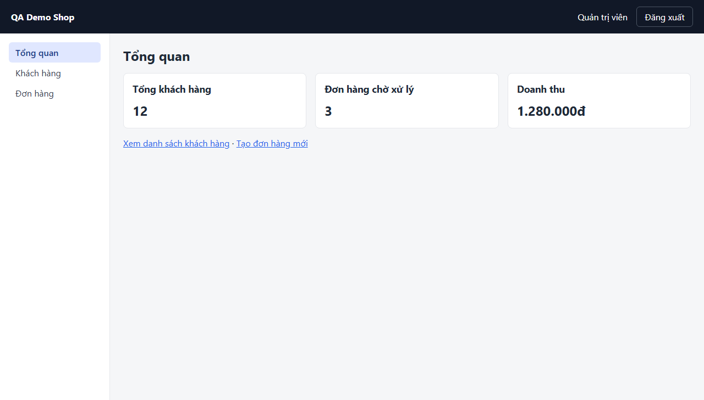

# Screen: dashboard

## Curated notes (AI/QA maintained — explorer never overwrites this section)

- **Purpose:** UNKNOWN — fill in from business docs or QA. Mark inferred statements with _(inferred, unverified)_.
- **Business rules / validation:** UNKNOWN
- **Dependencies on other screens:** UNKNOWN
- **Test data needs:** UNKNOWN
- **Known limitations / open questions:** —

<!-- AUTO-GENERATED:START (explorer overwrites this block; edit outside it) -->
## Overview (auto)

- **Route:** `/dashboard` — explored URL: http://localhost:4000/dashboard
- **Requires login:** yes
- **Document title:** Tổng quan · QA Demo Shop
- **Headings:** h1 "Tổng quan", h2 "Tổng khách hàng", h2 "Đơn hàng chờ xử lý", h2 "Doanh thu"
- **Last explored:** 2026-11-07T11:57:51.187Z
- **Screenshot:** 

## Interactive elements

| # | Type | Accessible name | Selector (verified unique) | Notes |
|---|---|---|---|---|
| 1 | button | Đăng xuất | `page.getByRole('button', { name: 'Đăng xuất' })` |  |
| 2 | link | Tổng quan | `page.getByRole('link', { name: 'Tổng quan' })` | aria-current=page; href /dashboard |
| 3 | link | Khách hàng | `page.getByRole('link', { name: 'Khách hàng', exact: true })` | href /customers |
| 4 | link | Đơn hàng | `page.getByRole('link', { name: 'Đơn hàng', exact: true })` | href /orders |
| 5 | link | Xem danh sách khách hàng | `page.getByRole('link', { name: 'Xem danh sách khách hàng' })` | href /customers |
| 6 | link | Tạo đơn hàng mới | `page.getByRole('link', { name: 'Tạo đơn hàng mới' })` | href /orders/new |

## Forms and fields

_No <form> elements visible._

## Tables

_none_

## Dialogs / modals

_none detected_

## Tabs

_none_

## Navigation menus and pagination

- navigation "Menu chính": Tổng quan → /dashboard (current), Khách hàng → /customers, Đơn hàng → /orders

## Notifications / live regions

- status (aria-live=polite) testid=`toast` id=`toast` — hidden on load

## Other elements with a test id (assertion targets)

| Selector | Tag | Visible on load | Text at exploration time |
|---|---|---|---|
| `page.getByTestId('current-user')` | span | yes | Quản trị viên |
| `page.getByTestId('stat-customers')` | p | yes | 12 |
| `page.getByTestId('stat-pending-orders')` | p | yes | 3 |
| `page.getByTestId('stat-revenue')` | p | yes | 1.280.000đ |
| `page.getByTestId('toast')` | div | no |  |

## Network calls on load (XHR/fetch)

- `GET /api/stats`

> Useful for `page.waitForResponse()` when the UI has no loading indicator. Query values are omitted.

## Outgoing navigation

| Link text | Target route | Target screen |
|---|---|---|
| Tổng quan | `/dashboard` | [dashboard](dashboard.md) |
| Khách hàng | `/customers` | [customers](customers.md) |
| Đơn hàng | `/orders` | [orders](orders.md) |
| Xem danh sách khách hàng | `/customers` | [customers](customers.md) |
| Tạo đơn hàng mới | `/orders/new` | [orders-new](orders-new.md) |

## States (captured by configured actions)

_No states configured for this screen. Add entries to `states` in explore.config.json to capture modals and validation messages._

## Accessibility snapshot on load

<details><summary>aria snapshot (YAML)</summary>

```yaml
- banner:
  - text: QA Demo Shop Quản trị viên
  - button "Đăng xuất"
- navigation "Menu chính":
  - link "Tổng quan":
    - /url: /dashboard
  - link "Khách hàng":
    - /url: /customers
  - link "Đơn hàng":
    - /url: /orders
- main:
  - heading "Tổng quan" [level=1]
  - region "Thống kê":
    - article:
      - heading "Tổng khách hàng" [level=2]
      - paragraph: "12"
    - article:
      - heading "Đơn hàng chờ xử lý" [level=2]
      - paragraph: "3"
    - article:
      - heading "Doanh thu" [level=2]
      - paragraph: 1.280.000đ
  - paragraph:
    - link "Xem danh sách khách hàng":
      - /url: /customers
    - text: ·
    - link "Tạo đơn hàng mới":
      - /url: /orders/new
```
</details>
<!-- AUTO-GENERATED:END -->
