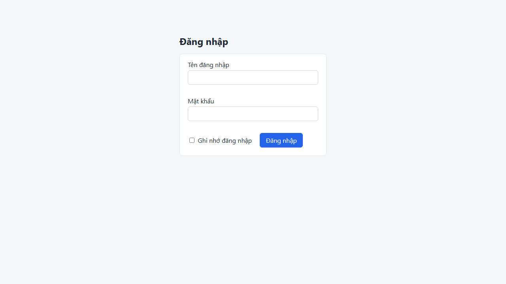
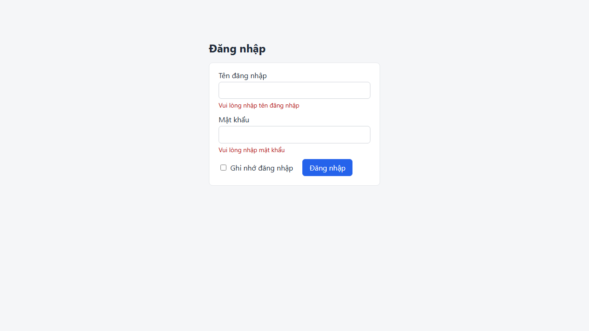
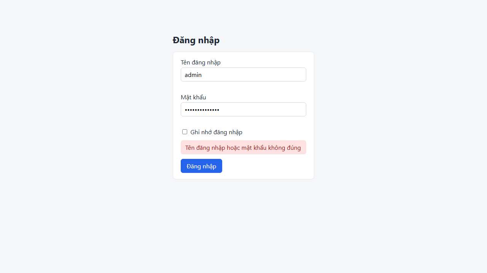

# Screen: login

## Curated notes (AI/QA maintained — explorer never overwrites this section)

- **Purpose:** UNKNOWN — fill in from business docs or QA. Mark inferred statements with _(inferred, unverified)_.
- **Business rules / validation:** UNKNOWN
- **Dependencies on other screens:** UNKNOWN
- **Test data needs:** UNKNOWN
- **Known limitations / open questions:** —

<!-- AUTO-GENERATED:START (explorer overwrites this block; edit outside it) -->
## Overview (auto)

- **Route:** `/login` — explored URL: http://localhost:4000/login
- **Requires login:** no
- **Document title:** Đăng nhập · QA Demo Shop
- **Headings:** h1 "Đăng nhập"
- **Last explored:** 2026-11-07T11:57:49.800Z
- **Screenshot:** 

## Interactive elements

| # | Type | Accessible name | Selector (verified unique) | Notes |
|---|---|---|---|---|
| 1 | textbox | Tên đăng nhập | `page.getByRole('textbox', { name: 'Tên đăng nhập' })` | autocomplete=username |
| 2 | input[password] | Mật khẩu | `page.getByLabel('Mật khẩu')` | type=password; autocomplete=current-password |
| 3 | checkbox | Ghi nhớ đăng nhập | `page.getByRole('checkbox', { name: 'Ghi nhớ đăng nhập' })` | unchecked; type=checkbox |
| 4 | button | Đăng nhập | `page.getByRole('button', { name: 'Đăng nhập' })` |  |

## Forms and fields

### Form `login-form`

| Field | Type | Required | Constraints | Selector |
|---|---|---|---|---|
| Tên đăng nhập | textbox |  | autocomplete=username | `page.getByRole('textbox', { name: 'Tên đăng nhập' })` |
| Mật khẩu | input[password] |  | autocomplete=current-password | `page.getByLabel('Mật khẩu')` |
| Ghi nhớ đăng nhập | checkbox |  |  | `page.getByRole('checkbox', { name: 'Ghi nhớ đăng nhập' })` |
| Đăng nhập | button |  |  | `page.getByRole('button', { name: 'Đăng nhập' })` |

> Validation messages are only known if a configured state triggers them (see **States**). Otherwise: UNKNOWN.

## Tables

_none_

## Dialogs / modals

_none detected_

## Tabs

_none_

## Navigation menus and pagination

_none_

## Notifications / live regions

- alert id=`login-error` — hidden on load
- status (aria-live=polite) testid=`toast` id=`toast` — hidden on load

## Other elements with a test id (assertion targets)

| Selector | Tag | Visible on load | Text at exploration time |
|---|---|---|---|
| `page.getByTestId('toast')` | div | no |  |

## Network calls on load (XHR/fetch)

_none_

## Outgoing navigation

_none_

## States (captured by configured actions)

### State `empty-submit` — Submit the login form with empty fields to capture validation messages

- Steps: `click role=button[name="Đăng nhập"]`
- URL after steps: http://localhost:4000/login
- Open dialogs: none
- Network calls triggered: none
- Texts that appeared (validation messages, toasts, ...): "Vui lòng nhập tên đăng nhập", "Vui lòng nhập mật khẩu"
- Screenshot: 

Elements that appeared in this state:

_none_

### State `wrong-password` — Login with an invalid password to capture the error alert

- Steps: `fill label="Tên đăng nhập" = "admin"` → `fill label="Mật khẩu" = "wrong-password"` → `click role=button[name="Đăng nhập"]` → `waitFor role=alert`
- URL after steps: http://localhost:4000/login
- Open dialogs: none
- Network calls triggered: `POST /api/login`
- Texts that appeared (validation messages, toasts, ...): "Tên đăng nhập hoặc mật khẩu không đúng"
- Screenshot: 

Elements that appeared in this state:

_none_

## Accessibility snapshot on load

<details><summary>aria snapshot (YAML)</summary>

```yaml
- main:
  - heading "Đăng nhập" [level=1]
  - text: Tên đăng nhập
  - textbox "Tên đăng nhập"
  - paragraph
  - text: Mật khẩu
  - textbox "Mật khẩu"
  - paragraph
  - checkbox "Ghi nhớ đăng nhập"
  - text: Ghi nhớ đăng nhập
  - button "Đăng nhập"
```
</details>
<!-- AUTO-GENERATED:END -->
