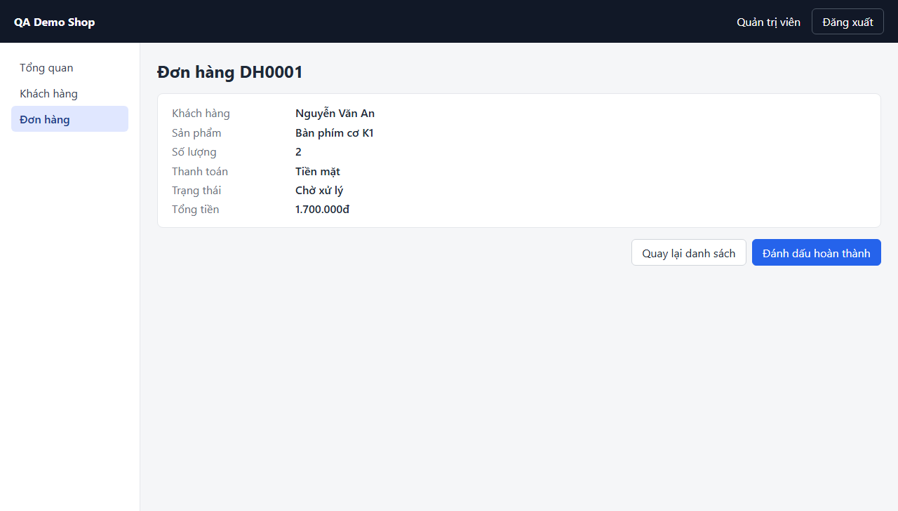

# Screen: orders-detail

## Curated notes (AI/QA maintained — explorer never overwrites this section)

- **Purpose:** show one order; a pending order can be marked as completed _(observed during exploration)_.
- **Business rules / validation:** "Đánh dấu hoàn thành" is present only while the status is "Chờ xử lý" (observed: this file = pending order DH0001; variant [orders-detail--completed](orders-detail--completed.md) = completed order DH0002 without the button).
- **Dependencies on other screens:** reached from the order code link in [orders](orders.md) and after creating an order in [orders-new](orders-new.md).
- **Test data needs:** an order in the required status — create it in the test (TC-ORD-006) instead of relying on seed orders.
- **Known limitations / open questions:** no "In hóa đơn" control in any status (TC-ORD-007 is BLOCKED).

<!-- AUTO-GENERATED:START (explorer overwrites this block; edit outside it) -->
## Overview (auto)

- **Route:** `/orders/:id` — explored URL: http://localhost:4000/orders/1
- **Requires login:** yes
- **Document title:** Đơn hàng DH0001 · QA Demo Shop
- **Headings:** h1 "Đơn hàng DH0001"
- **Last explored:** 2026-11-07T11:57:52.432Z
- **Screenshot:** 

## Interactive elements

| # | Type | Accessible name | Selector (verified unique) | Notes |
|---|---|---|---|---|
| 1 | button | Đăng xuất | `page.getByRole('button', { name: 'Đăng xuất' })` |  |
| 2 | link | Tổng quan | `page.getByRole('link', { name: 'Tổng quan' })` | href /dashboard |
| 3 | link | Khách hàng | `page.getByRole('link', { name: 'Khách hàng' })` | href /customers |
| 4 | link | Đơn hàng | `page.getByRole('link', { name: 'Đơn hàng' })` | aria-current=page; href /orders |
| 5 | link | Quay lại danh sách | `page.getByRole('link', { name: 'Quay lại danh sách' })` | href /orders |
| 6 | button | Đánh dấu hoàn thành | `page.getByRole('button', { name: 'Đánh dấu hoàn thành' })` |  |

## Forms and fields

_No <form> elements visible._

## Tables

_none_

## Dialogs / modals

_none detected_

## Tabs

_none_

## Navigation menus and pagination

- navigation "Menu chính": Tổng quan → /dashboard, Khách hàng → /customers, Đơn hàng → /orders (current)

## Notifications / live regions

- status (aria-live=polite) testid=`toast` id=`toast` — hidden on load

## Other elements with a test id (assertion targets)

| Selector | Tag | Visible on load | Text at exploration time |
|---|---|---|---|
| `page.getByTestId('current-user')` | span | yes | Quản trị viên |
| `page.getByTestId('order-customer')` | dd | yes | Nguyễn Văn An |
| `page.getByTestId('order-product')` | dd | yes | Bàn phím cơ K1 |
| `page.getByTestId('order-quantity')` | dd | yes | 2 |
| `page.getByTestId('order-payment')` | dd | yes | Tiền mặt |
| `page.getByTestId('order-status')` | dd | yes | Chờ xử lý |
| `page.getByTestId('order-detail-total')` | dd | yes | 1.700.000đ |
| `page.getByTestId('toast')` | div | no |  |

## Network calls on load (XHR/fetch)

_none_

## Outgoing navigation

| Link text | Target route | Target screen |
|---|---|---|
| Tổng quan | `/dashboard` | [dashboard](dashboard.md) |
| Khách hàng | `/customers` | [customers](customers.md) |
| Đơn hàng | `/orders` | [orders](orders.md) |
| Quay lại danh sách | `/orders` | [orders](orders.md) |

## States (captured by configured actions)

_No states configured for this screen. Add entries to `states` in explore.config.json to capture modals and validation messages._

## Accessibility snapshot on load

<details><summary>aria snapshot (YAML)</summary>

```yaml
- banner:
  - text: QA Demo Shop Quản trị viên
  - button "Đăng xuất"
- navigation "Menu chính":
  - link "Tổng quan":
    - /url: /dashboard
  - link "Khách hàng":
    - /url: /customers
  - link "Đơn hàng":
    - /url: /orders
- main:
  - heading "Đơn hàng DH0001" [level=1]
  - term: Khách hàng
  - definition: Nguyễn Văn An
  - term: Sản phẩm
  - definition: Bàn phím cơ K1
  - term: Số lượng
  - definition: "2"
  - term: Thanh toán
  - definition: Tiền mặt
  - term: Trạng thái
  - definition: Chờ xử lý
  - term: Tổng tiền
  - definition: 1.700.000đ
  - link "Quay lại danh sách":
    - /url: /orders
  - button "Đánh dấu hoàn thành"
```
</details>
<!-- AUTO-GENERATED:END -->
