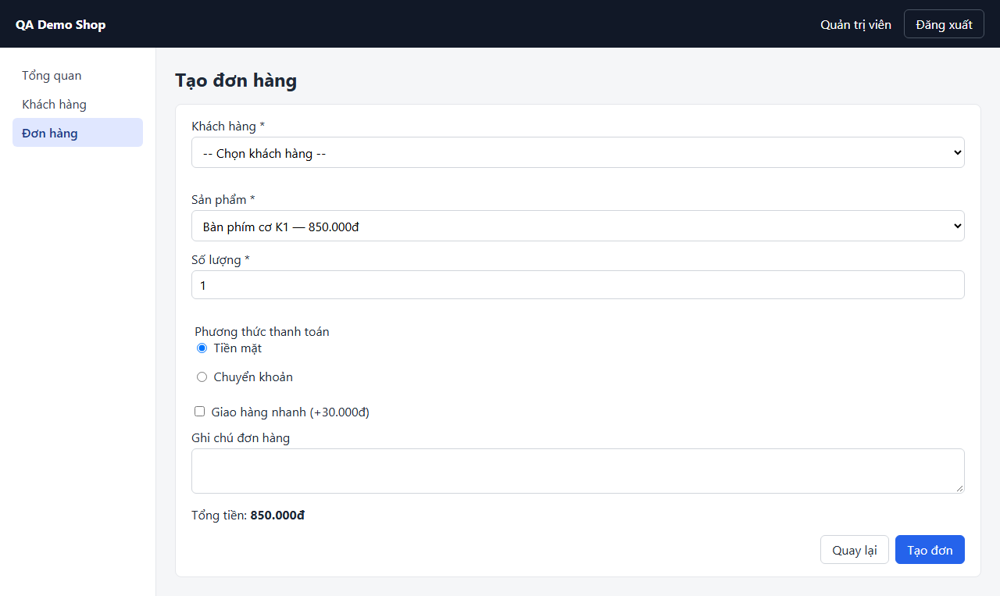
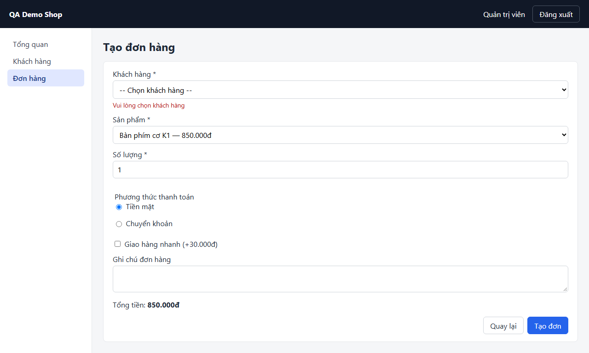

# Screen: orders-new

## Curated notes (AI/QA maintained — explorer never overwrites this section)

- **Purpose:** UNKNOWN — fill in from business docs or QA. Mark inferred statements with _(inferred, unverified)_.
- **Business rules / validation:** UNKNOWN
- **Dependencies on other screens:** UNKNOWN
- **Test data needs:** UNKNOWN
- **Known limitations / open questions:** —

<!-- AUTO-GENERATED:START (explorer overwrites this block; edit outside it) -->
## Overview (auto)

- **Route:** `/orders/new` — explored URL: http://localhost:4000/orders/new
- **Requires login:** yes
- **Document title:** Tạo đơn hàng · QA Demo Shop
- **Headings:** h1 "Tạo đơn hàng"
- **Last explored:** 2026-11-07T11:57:56.528Z
- **Screenshot:** 

## Interactive elements

| # | Type | Accessible name | Selector (verified unique) | Notes |
|---|---|---|---|---|
| 1 | button | Đăng xuất | `page.getByRole('button', { name: 'Đăng xuất' })` |  |
| 2 | link | Tổng quan | `page.getByRole('link', { name: 'Tổng quan' })` | href /dashboard |
| 3 | link | Khách hàng | `page.getByRole('link', { name: 'Khách hàng' })` | href /customers |
| 4 | link | Đơn hàng | `page.getByRole('link', { name: 'Đơn hàng' })` | aria-current=page; href /orders |
| 5 | combobox | Khách hàng * | `page.getByRole('combobox', { name: 'Khách hàng *' })` | options: -- Chọn khách hàng -- / Nguyễn Văn An / Trần Thị Bình / Phạm Minh Dũng / Hoàng Thu Hà / Đặng Ngọc Lan / Bùi Quang Minh / Đỗ Thanh Nga / Ngô Gia Phúc / Lý Thành Sơn |
| 6 | combobox | Sản phẩm * | `page.getByRole('combobox', { name: 'Sản phẩm *' })` | options: Bàn phím cơ K1 — 850.000đ / Chuột không dây M2 — 320.000đ / Màn hình 24 inch — 3.200.000đ |
| 7 | spinbutton | Số lượng * | `page.getByRole('spinbutton', { name: 'Số lượng *' })` | type=number; min=1; max=100 |
| 8 | radio | Tiền mặt | `page.getByRole('radio', { name: 'Tiền mặt' })` | checked; type=radio; group "Phương thức thanh toán" |
| 9 | radio | Chuyển khoản | `page.getByRole('radio', { name: 'Chuyển khoản' })` | unchecked; type=radio; group "Phương thức thanh toán" |
| 10 | checkbox | Giao hàng nhanh (+30.000đ) | `page.getByRole('checkbox', { name: 'Giao hàng nhanh (+30.000đ)' })` | unchecked; type=checkbox |
| 11 | textbox | Ghi chú đơn hàng | `page.getByRole('textbox', { name: 'Ghi chú đơn hàng' })` |  |
| 12 | link | Quay lại | `page.getByRole('link', { name: 'Quay lại' })` | href /orders |
| 13 | button | Tạo đơn | `page.getByRole('button', { name: 'Tạo đơn' })` |  |

## Forms and fields

### Form `order-form`

| Field | Type | Required | Constraints | Selector |
|---|---|---|---|---|
| Khách hàng * | combobox |  |  options: -- Chọn khách hàng -- / Nguyễn Văn An / Trần Thị Bình / Phạm Minh Dũng / Hoàng Thu Hà / Đặng Ngọc Lan / Bùi Quang Minh / Đỗ Thanh Nga / Ngô Gia Phúc / Lý Thành Sơn | `page.getByRole('combobox', { name: 'Khách hàng *' })` |
| Sản phẩm * | combobox |  |  options: Bàn phím cơ K1 — 850.000đ / Chuột không dây M2 — 320.000đ / Màn hình 24 inch — 3.200.000đ | `page.getByRole('combobox', { name: 'Sản phẩm *' })` |
| Số lượng * | spinbutton |  | min=1, max=100 | `page.getByRole('spinbutton', { name: 'Số lượng *' })` |
| Tiền mặt | radio |  |  | `page.getByRole('radio', { name: 'Tiền mặt' })` |
| Chuyển khoản | radio |  |  | `page.getByRole('radio', { name: 'Chuyển khoản' })` |
| Giao hàng nhanh (+30.000đ) | checkbox |  |  | `page.getByRole('checkbox', { name: 'Giao hàng nhanh (+30.000đ)' })` |
| Ghi chú đơn hàng | textbox |  |  | `page.getByRole('textbox', { name: 'Ghi chú đơn hàng' })` |
| Quay lại | link |  |  | `page.getByRole('link', { name: 'Quay lại' })` |
| Tạo đơn | button |  |  | `page.getByRole('button', { name: 'Tạo đơn' })` |

> Validation messages are only known if a configured state triggers them (see **States**). Otherwise: UNKNOWN.

## Tables

_none_

## Dialogs / modals

_none detected_

## Tabs

_none_

## Navigation menus and pagination

- navigation "Menu chính": Tổng quan → /dashboard, Khách hàng → /customers, Đơn hàng → /orders (current)

## Notifications / live regions

- live-region (aria-live=polite) testid=`order-total` — visible: "850.000đ"
- status (aria-live=polite) testid=`toast` id=`toast` — hidden on load

## Other elements with a test id (assertion targets)

| Selector | Tag | Visible on load | Text at exploration time |
|---|---|---|---|
| `page.getByTestId('current-user')` | span | yes | Quản trị viên |
| `page.getByTestId('order-total')` | strong | yes | 850.000đ |
| `page.getByTestId('toast')` | div | no |  |

## Network calls on load (XHR/fetch)

- `GET /api/products`
- `GET /api/customers?status&pageSize`

> Useful for `page.waitForResponse()` when the UI has no loading indicator. Query values are omitted.

## Outgoing navigation

| Link text | Target route | Target screen |
|---|---|---|
| Tổng quan | `/dashboard` | [dashboard](dashboard.md) |
| Khách hàng | `/customers` | [customers](customers.md) |
| Đơn hàng | `/orders` | [orders](orders.md) |
| Quay lại | `/orders` | [orders](orders.md) |

## States (captured by configured actions)

### State `empty-submit` — Submit the order form without choosing a customer (rejected, creates nothing)

- Steps: `click role=button[name="Tạo đơn"]` → `wait 600ms`
- URL after steps: http://localhost:4000/orders/new
- Open dialogs: none
- Network calls triggered: `POST /api/orders`
- Texts that appeared (validation messages, toasts, ...): "Vui lòng chọn khách hàng"
- Screenshot: 

Elements that appeared in this state:

_none_

## Accessibility snapshot on load

<details><summary>aria snapshot (YAML)</summary>

```yaml
- banner:
  - text: QA Demo Shop Quản trị viên
  - button "Đăng xuất"
- navigation "Menu chính":
  - link "Tổng quan":
    - /url: /dashboard
  - link "Khách hàng":
    - /url: /customers
  - link "Đơn hàng":
    - /url: /orders
- main:
  - heading "Tạo đơn hàng" [level=1]
  - text: Khách hàng *
  - combobox "Khách hàng *":
    - option "-- Chọn khách hàng --" [selected]
    - option "Nguyễn Văn An"
    - option "Trần Thị Bình"
    - option "Phạm Minh Dũng"
    - option "Hoàng Thu Hà"
    - option "Đặng Ngọc Lan"
    - option "Bùi Quang Minh"
    - option "Đỗ Thanh Nga"
    - option "Ngô Gia Phúc"
    - option "Lý Thành Sơn"
  - paragraph
  - text: Sản phẩm *
  - combobox "Sản phẩm *":
    - option "Bàn phím cơ K1 — 850.000đ" [selected]
    - option "Chuột không dây M2 — 320.000đ"
    - option "Màn hình 24 inch — 3.200.000đ"
  - text: Số lượng *
  - spinbutton "Số lượng *": "1"
  - paragraph
  - group "Phương thức thanh toán":
    - text: Phương thức thanh toán
    - radio "Tiền mặt" [checked]
    - text: Tiền mặt
    - radio "Chuyển khoản"
    - text: Chuyển khoản
  - checkbox "Giao hàng nhanh (+30.000đ)"
  - text: Giao hàng nhanh (+30.000đ) Ghi chú đơn hàng
  - textbox "Ghi chú đơn hàng"
  - paragraph:
    - text: "Tổng tiền:"
    - strong: 850.000đ
  - link "Quay lại":
    - /url: /orders
  - button "Tạo đơn"
```
</details>
<!-- AUTO-GENERATED:END -->
