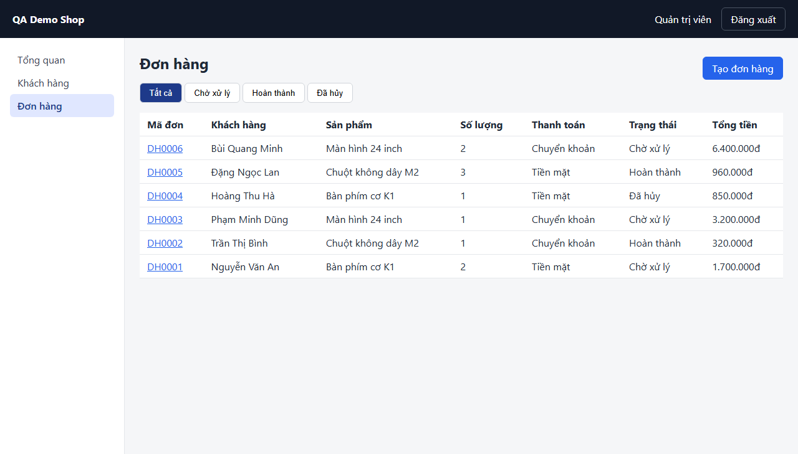

# Screen: orders

## Curated notes (AI/QA maintained — explorer never overwrites this section)

- **Purpose:** UNKNOWN — fill in from business docs or QA. Mark inferred statements with _(inferred, unverified)_.
- **Business rules / validation:** UNKNOWN
- **Dependencies on other screens:** UNKNOWN
- **Test data needs:** UNKNOWN
- **Known limitations / open questions:** —

<!-- AUTO-GENERATED:START (explorer overwrites this block; edit outside it) -->
## Overview (auto)

- **Route:** `/orders` — explored URL: http://localhost:4000/orders
- **Requires login:** yes
- **Document title:** Đơn hàng · QA Demo Shop
- **Headings:** h1 "Đơn hàng"
- **Last explored:** 2026-11-07T11:57:55.150Z
- **Screenshot:** 

## Interactive elements

| # | Type | Accessible name | Selector (verified unique) | Notes |
|---|---|---|---|---|
| 1 | button | Đăng xuất | `page.getByRole('button', { name: 'Đăng xuất' })` |  |
| 2 | link | Tổng quan | `page.getByRole('link', { name: 'Tổng quan' })` | href /dashboard |
| 3 | link | Khách hàng | `page.getByRole('link', { name: 'Khách hàng' })` | href /customers |
| 4 | link | Đơn hàng | `page.getByRole('link', { name: 'Đơn hàng', exact: true })` | aria-current=page; href /orders |
| 5 | link | Tạo đơn hàng | `page.getByRole('link', { name: 'Tạo đơn hàng' })` | href /orders/new |
| 6 | tab | Tất cả | `page.getByRole('tab', { name: 'Tất cả' })` | aria-selected=true |
| 7 | tab | Chờ xử lý | `page.getByRole('tab', { name: 'Chờ xử lý' })` | aria-selected=false |
| 8 | tab | Hoàn thành | `page.getByRole('tab', { name: 'Hoàn thành' })` | aria-selected=false |
| 9 | tab | Đã hủy | `page.getByRole('tab', { name: 'Đã hủy' })` | aria-selected=false |

## Forms and fields

_No <form> elements visible._

## Tables

### Table "Danh sách đơn hàng" — `page.getByRole('table', { name: 'Danh sách đơn hàng' })`

- Columns: `Mã đơn` | `Khách hàng` | `Sản phẩm` | `Số lượng` | `Thanh toán` | `Trạng thái` | `Tổng tiền`
- Visible rows at exploration time: 6
- Sample first row: "DH0006", "Bùi Quang Minh", "Màn hình 24 inch", "2", "Chuyển khoản", "Chờ xử lý", "6.400.000đ"
- Row-level controls (locate the row first, e.g. `const row = page.getByRole('table', { name: 'Danh sách đơn hàng' }).getByRole('row').filter({ hasText: '<unique cell text>' })`):

| # | Type | Accessible name | Selector (verified unique) | Notes |
|---|---|---|---|---|
| 1 | link | DH0006 | `page.getByRole('link', { name: 'DH0006' })` | href /orders/6; per-row control in table "Danh sách đơn hàng" (6 visible rows) |

## Dialogs / modals

_none detected_

## Tabs

- tablist "Lọc theo trạng thái": **Tất cả** (selected), Chờ xử lý, Hoàn thành, Đã hủy

## Navigation menus and pagination

- navigation "Menu chính": Tổng quan → /dashboard, Khách hàng → /customers, Đơn hàng → /orders (current)

## Notifications / live regions

- status (aria-live=polite) testid=`toast` id=`toast` — hidden on load

## Other elements with a test id (assertion targets)

| Selector | Tag | Visible on load | Text at exploration time |
|---|---|---|---|
| `page.getByTestId('current-user')` | span | yes | Quản trị viên |
| `page.getByTestId('toast')` | div | no |  |

## Network calls on load (XHR/fetch)

- `GET /api/orders?status`

> Useful for `page.waitForResponse()` when the UI has no loading indicator. Query values are omitted.

## Outgoing navigation

| Link text | Target route | Target screen |
|---|---|---|
| Tổng quan | `/dashboard` | [dashboard](dashboard.md) |
| Khách hàng | `/customers` | [customers](customers.md) |
| Đơn hàng | `/orders` | [orders](orders.md) |
| Tạo đơn hàng | `/orders/new` | [orders-new](orders-new.md) |
| DH0006 | `/orders/:id` | [orders-detail](orders-detail.md) |
| DH0005 | `/orders/:id` | [orders-detail](orders-detail.md) |
| DH0004 | `/orders/:id` | [orders-detail](orders-detail.md) |
| DH0003 | `/orders/:id` | [orders-detail](orders-detail.md) |
| DH0002 | `/orders/:id` | [orders-detail](orders-detail.md) |
| DH0001 | `/orders/:id` | [orders-detail](orders-detail.md) |

## States (captured by configured actions)

_No states configured for this screen. Add entries to `states` in explore.config.json to capture modals and validation messages._

> Note: 5 repeated per-row controls in other table rows were collapsed.

## Accessibility snapshot on load

<details><summary>aria snapshot (YAML)</summary>

```yaml
- banner:
  - text: QA Demo Shop Quản trị viên
  - button "Đăng xuất"
- navigation "Menu chính":
  - link "Tổng quan":
    - /url: /dashboard
  - link "Khách hàng":
    - /url: /customers
  - link "Đơn hàng":
    - /url: /orders
- main:
  - heading "Đơn hàng" [level=1]
  - link "Tạo đơn hàng":
    - /url: /orders/new
  - tablist "Lọc theo trạng thái":
    - tab "Tất cả" [selected]
    - tab "Chờ xử lý"
    - tab "Hoàn thành"
    - tab "Đã hủy"
  - tabpanel "Kết quả":
    - table "Danh sách đơn hàng":
      - rowgroup:
        - row "Mã đơn Khách hàng Sản phẩm Số lượng Thanh toán Trạng thái Tổng tiền":
          - columnheader "Mã đơn"
          - columnheader "Khách hàng"
          - columnheader "Sản phẩm"
          - columnheader "Số lượng"
          - columnheader "Thanh toán"
          - columnheader "Trạng thái"
          - columnheader "Tổng tiền"
      - rowgroup:
        - row "DH0006 Bùi Quang Minh Màn hình 24 inch 2 Chuyển khoản Chờ xử lý 6.400.000đ":
          - cell "DH0006":
            - link "DH0006":
              - /url: /orders/6
          - cell "Bùi Quang Minh"
          - cell "Màn hình 24 inch"
          - cell "2"
          - cell "Chuyển khoản"
          - cell "Chờ xử lý"
          - cell "6.400.000đ"
        - row "DH0005 Đặng Ngọc Lan Chuột không dây M2 3 Tiền mặt Hoàn thành 960.000đ":
          - cell "DH0005":
            - link "DH0005":
              - /url: /orders/5
          - cell "Đặng Ngọc Lan"
          - cell "Chuột không dây M2"
          - cell "3"
          - cell "Tiền mặt"
          - cell "Hoàn thành"
          - cell "960.000đ"
        - row "DH0004 Hoàng Thu Hà Bàn phím cơ K1 1 Tiền mặt Đã hủy 850.000đ":
          - cell "DH0004":
            - link "DH0004":
              - /url: /orders/4
          - cell "Hoàng Thu Hà"
          - cell "Bàn phím cơ K1"
          - cell "1"
          - cell "Tiền mặt"
          - cell "Đã hủy"
          - cell "850.000đ"
        - row "DH0003 Phạm Minh Dũng Màn hình 24 inch 1 Chuyển khoản Chờ xử lý 3.200.000đ":
          - cell "DH0003":
            - link "DH0003":
              - /url: /orders/3
          - cell "Phạm Minh Dũng"
          - cell "Màn hình 24 inch"
          - cell "1"
          - cell "Chuyển khoản"
          - cell "Chờ xử lý"
          - cell "3.200.000đ"
        - row "DH0002 Trần Thị Bình Chuột không dây M2 1 Chuyển khoản Hoàn thành 320.000đ":
          - cell "DH0002":
            - link "DH0002":
              - /url: /orders/2
          - cell "Trần Thị Bình"
          - cell "Chuột không dây M2"
          - cell "1"
          - cell "Chuyển khoản"
          - cell "Hoàn thành"
          - cell "320.000đ"
        - row "DH0001 Nguyễn Văn An Bàn phím cơ K1 2 Tiền mặt Chờ xử lý 1.700.000đ":
          - cell "DH0001":
            - link "DH0001":
              - /url: /orders/1
          - cell "Nguyễn Văn An"
          - cell "Bàn phím cơ K1"
          - cell "2"
          - cell "Tiền mặt"
          - cell "Chờ xử lý"
          - cell "1.700.000đ"
```
</details>
<!-- AUTO-GENERATED:END -->
